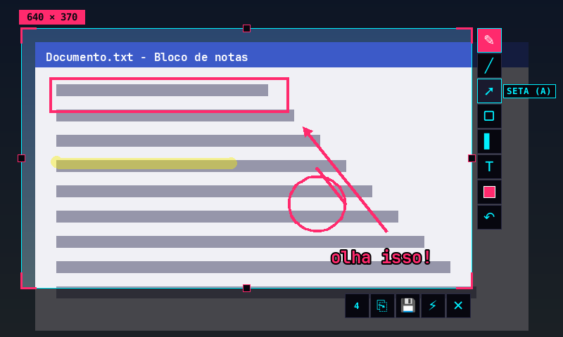
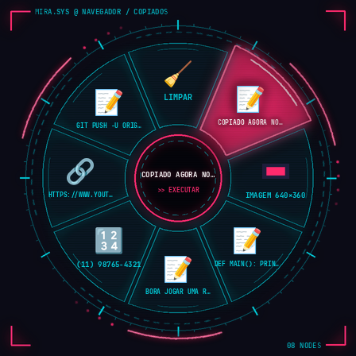

# Mira — roda de atalhos no Mouse 4

Segure o **Mouse 4** (botão lateral do mouse), aponte para um atalho e solte.


Visual neon/ciberpunk: brilho de verdade (transparência por pixel), anéis girando,
scanlines, pulso na opção escolhida e um glitch rápido quando a roda abre.

- **Segurar e soltar:** segure o Mouse 4, mova o mouse na direção do atalho e solte.
- **Clique rápido:** um toque no Mouse 4 deixa a roda aberta; aí é só clicar no atalho.
- **Camadas:** itens com uma setinha (▸) abrem mais opções. É só **parar o mouse em cima**
  (uma barrinha enche e a camada abre), **clicar**, ou **empurrar o mouse para fora** da roda.
  Dá para ir descendo segurando o Mouse 4 o tempo todo e soltar no que quiser.
- **Voltar uma camada:** clique no centro ou use o botão direito.
- **Fechar:** `Esc` ou apertar o Mouse 4 de novo.
- O Mouse 4 deixa de funcionar como "Voltar" no navegador enquanto o Mira estiver aberto.

O que já vem pronto:

| Item         | Abre                                                                        |
|--------------|-----------------------------------------------------------------------------|
| Jogos ▸      | **Seus jogos instalados**, achados sozinhos na Steam, Epic e Riot, com os ícones. Os que você jogou por último vêm primeiro |
| Steam ▸      | Abrir Steam, Biblioteca, Loja, Amigos, Downloads                            |
| Discord      | —                                                                           |
| Recortar     | Recorte de uma área da tela                                                 |
| Copiados ▸   | **Histórico do Ctrl+C**: os últimos textos e imagens copiados — escolha um e ele é colado no programa aberto |
| Tela inteira | Print de todas as telas                                                     |
| Navegador ▸  | Google, YouTube, Twitch, WhatsApp, Gmail                                    |
| Arquivos ▸   | Área de Trabalho, Downloads, Documentos, Imagens, Vídeos, Músicas, Prints, Disco C: — e dentro de cada uma, as pastas e arquivos que estão lá |
| Mídia ▸      | Play/Pause, Próxima, Anterior, Volume +/-, Mudo (a roda fica aberta para apertar várias vezes) |
| Sistema ▸    | Gerenciador de Tarefas, Configurações, Bloquear, Lixeira, Desligar          |

Nas pastas, as subpastas vêm primeiro e cada uma abre outra camada. Arquivos e atalhos
aparecem com o ícone de verdade (o mesmo do Explorador). A primeira opção, **Abrir pasta**,
abre a pasta no Explorador, e se tiver muita coisa aparece **Mais (N)** para a próxima página.

## Instalação (Windows 10/11)

### Jeito fácil: Mira.exe

**[⬇ Baixar o Mira.exe](https://github.com/Darkinhux/mira/releases/latest/download/Mira.exe)**
(sempre a versão mais nova). Coloque numa pasta só dele e abra. Não precisa instalar nada.
O `config.json` é criado ao lado do `.exe` na primeira vez.

> O Windows SmartScreen ou o antivírus podem estranhar um `.exe` novo e sem assinatura.
> Clique em "Mais informações" → "Executar assim mesmo".

Para gerar o `.exe` você mesmo: dois cliques em **`criar_exe.bat`**.

### Com Python

1. Instale o [Python 3.11 ou mais novo](https://www.python.org/downloads/) e marque
   **"Add python.exe to PATH"** na instalação.
2. Baixe esta pasta e dê dois cliques em **`instalar.bat`**.
3. Dê dois cliques em **`iniciar.bat`**. Vai aparecer um ícone perto do relógio.

Para abrir junto com o Windows, clique com o botão direito no ícone perto do relógio
e marque **"Iniciar com o Windows"**.

## Recorte de tela (estilo Lightshot)

Aperte **PrtSc** (ou escolha **Recortar** na roda) e arraste para selecionar uma área.



- **Ajustar:** puxe as alças para redimensionar ou arraste por dentro para mover.
  Arrastar fora da seleção começa uma nova.
- **Desenhar** (barra ao lado): Lápis `P`, Linha `L`, Seta `A`, Retângulo `R`,
  Marca-texto `M`, **Pixelar `B`** (esconde nome, e-mail, chat…), Texto `T`, cor e
  desfazer (`Ctrl+Z`). A **roda do mouse** muda a
  espessura (e o tamanho do texto). O botão direito solta a ferramenta.
- **Terminar** (barra de baixo):

| Atalho                    | O que faz                                                    |
|---------------------------|--------------------------------------------------------------|
| `Ctrl+C`                  | Copia (é só colar com `Ctrl+V` no Discord, por exemplo)       |
| `Ctrl+S`                  | Salvar como… (escolhe onde e o nome)                          |
| `Enter` ou duplo clique   | Copia **e** salva em `Imagens\Mira`                          |
| `Esc`                     | Cancela                                                      |

Para o PrtSc não abrir o recorte do Mira, use `"print_screen": false` no `config.json`.

## Histórico do Ctrl+C (Copiados ▸)



O Mira guarda os últimos 25 textos e imagens que você copiou. Na camada **Copiados ▸**,
escolha um e ele vai para a área de transferência **e já é colado** (Ctrl+V) no programa
que está aberto. Links aparecem com 🔗, números com 🔢 e imagens em miniatura.
**Limpar** apaga o histórico.

- **Privacidade:** o histórico fica só na memória e some quando o Mira fecha. Senhas copiadas
  de gerenciadores (Bitwarden, 1Password, KeePass…) **não** entram, porque eles marcam o
  conteúdo como privado e o Mira respeita isso.
- Para o histórico sobreviver a reinícios: `"clipboard_save": true` (só os textos são salvos,
  em `copiados.json`). Para desligar tudo: `"clipboard_history": false`.

## Perfil por programa

A roda muda conforme o programa que está na frente. Já vem com dois perfis:

- **Navegador** (Chrome, Edge, Brave, Firefox, Opera, Vivaldi): Nova aba, Reabrir aba,
  Anônima, Recortar, Copiados, Downloads, Fechar aba e **Geral** (a roda normal).
- **Valorant**: Recortar, Tela inteira, Discord, Mídia, Copiados e Geral.

O nome do perfil aparece no centro e no canto (`MIRA.SYS @ NAVEGADOR`). Para criar o seu, use
`profiles` no `config.json`. O `match` é o nome do `.exe` (aceita `*`), que você encontra no
Gerenciador de Tarefas → Detalhes. Também dá para usar `title`, um pedaço do título da janela.

```json
"profiles": [
  { "name": "Minecraft", "match": ["javaw.exe", "Minecraft*.exe"], "items": [
      { "name": "Recortar", "icon": "✂️", "type": "snip" },
      { "name": "Prints",   "icon": "📸", "type": "folder", "path": "%APPDATA%\\.minecraft\\screenshots" },
      { "name": "Geral",    "icon": "🧭", "type": "default" }
  ]}
]
```

## Personalizar os atalhos

Clique com o botão direito no ícone perto do relógio → **Editar atalhos**, mude o
`config.json` e depois → **Recarregar atalhos**. Cada camada aceita até 12 itens.

```json
{ "name": "Spotify",  "icon": "🎵", "type": "open",  "target": "spotify:" }
{ "name": "Valorant", "icon": "🔫", "type": "open",  "target": "C:\\Riot Games\\Riot Client\\RiotClientServices.exe",
  "args": ["--launch-product=valorant", "--launch-patchline=live"] }
{ "name": "YouTube",  "icon": "▶️", "type": "open",  "target": "https://youtube.com" }
{ "name": "Mutar",    "icon": "🔇", "type": "keys",  "keys": "media_volume_mute" }
{ "name": "Bloquear", "icon": "🔒", "type": "command", "command": "rundll32.exe user32.dll,LockWorkStation" }
{ "name": "Desligar", "icon": "⏻",  "type": "command", "command": "shutdown /s /t 60" }
{ "name": "Recortar", "icon": "✂️", "type": "snip" }
{ "name": "Print",    "icon": "🖥️", "type": "screenshot" }
{ "name": "Jogos",    "icon": "🕹️", "type": "folder", "path": "D:\\Jogos" }
{ "name": "Volume +", "icon": "🔊", "type": "keys", "keys": "media_volume_up", "stay": true }
```

Um submenu é um item `menu` com os próprios `items` dentro (pode ter menu dentro de menu):

```json
{ "name": "Jogos", "icon": "🕹️", "type": "menu", "items": [
    { "name": "CS2",       "icon": "🔫", "type": "open", "target": "steam://rungameid/730" },
    { "name": "Minecraft", "icon": "auto", "type": "open", "target": "C:\\XboxGames\\Minecraft Launcher\\Content\\Minecraft.exe" }
]}
```

| `type`       | O que faz                                                              | Campos            |
|--------------|------------------------------------------------------------------------|-------------------|
| `open`       | Abre programa, pasta, site ou protocolo (`steam://`, `discord://`…)    | `target`, `args`  |
| `keys`       | Aperta uma combinação de teclas (`ctrl+shift+esc`, `win+e`, `media_next`) | `keys`         |
| `command`    | Roda um comando do Prompt                                              | `command`         |
| `snip`       | Recorte de uma área da tela                                            | —                 |
| `screenshot` | Print de todas as telas                                                | —                 |
| `menu`       | Abre uma camada com mais itens                                         | `items`           |
| `folder`     | Abre uma camada com as pastas e arquivos de uma pasta                  | `path`            |
| `games`      | Abre uma camada com os jogos instalados                                | `sources` (`steam`, `epic`, `riot`) |
| `clipboard`  | Abre o histórico do Ctrl+C                                             | —                 |
| `default`    | Abre a roda normal (útil dentro de um perfil)                          | —                 |

Qualquer item com `"stay": true` não fecha a roda depois de usado.

Nos caminhos dá para usar `{desktop}`, `{downloads}`, `{documents}`, `{pictures}`,
`{videos}` e `{music}`: o Mira acha a pasta certa mesmo se ela estiver no OneDrive.

O `icon` pode ser um emoji, o caminho de uma imagem (`.png`, `.ico`…), por exemplo
`"icons/steam.png"`, ou `"auto"` para usar o ícone do próprio programa do `target`.
Caminhos podem usar `%LOCALAPPDATA%` e afins.

Atalhos de jogos da Steam: `"target": "steam://rungameid/730"` (troque o número pelo ID do jogo).

Outras opções do `config.json` (troque as cores para criar seu tema — ex.: `neon` `#f9f002` e `accent` `#00f0ff`):

| Opção               | Padrão              | Descrição                                     |
|---------------------|---------------------|-----------------------------------------------|
| `trigger`           | `mouse4`            | `mouse4`, `mouse5` ou `middle` (roda do mouse) |
| `radius`            | `170`               | Tamanho da roda                               |
| `inner_radius`      | `55`                | Tamanho do círculo do meio                    |
| `neon`              | `#00f0ff`           | Cor neon principal (linhas e textos)          |
| `accent`            | `#ff2a6d`           | Cor de destaque (opção escolhida, cantoneiras) |
| `background`        | `#0b0b16`           | Cor de fundo das fatias                       |
| `animations`        | `true`              | `false` desliga as animações (PC mais fraco)  |
| `hover_open_ms`     | `450`               | Tempo parado em cima para abrir uma camada (`0` = só clicando) |
| `print_screen`      | `true`              | A tecla PrtSc abre o recorte do Mira          |
| `clipboard_history` | `true`              | Liga o histórico do Ctrl+C                    |
| `clipboard_max`     | `25`                | Quantos itens o histórico guarda              |
| `clipboard_save`    | `false`             | Salva os textos copiados em `copiados.json`   |
| `profiles`          | Navegador, Valorant | Rodas por programa (veja acima)               |
| `screenshot_folder` | `{pictures}/Mira`   | Onde os prints são salvos                     |

## Problemas comuns

- **A roda não aparece no jogo:** jogos em *tela cheia exclusiva* ficam por cima de tudo.
  Use o modo **"janela sem bordas" (borderless)** nas configurações do jogo.
- **Não funciona em programas abertos como administrador:** o Windows bloqueia isso.
  Execute o Mira como administrador também.
- **Um jogo não aparece em Jogos ▸:** por enquanto o Mira encontra jogos da Steam, Epic e Riot.
  Para outros, crie um item `open` apontando para o `.exe` com `"icon": "auto"`.
- **Algo deu errado:** veja o arquivo `mira.log` nesta pasta.

## Testes

`python -m pytest tests`. No GitHub, a cada mudança, um Windows de verdade roda todos os
testes: abre a roda e confere a transparência com um print da tela, simula o Mouse 4 e o
PrtSc, testa os ícones e a área de transferência. Depois ele gera e abre o `Mira.exe`.
Os prints ficam em *Artifacts* → **prints-dos-testes**, e o `.exe` testado é publicado
nas [Releases](https://github.com/Darkinhux/mira/releases).
